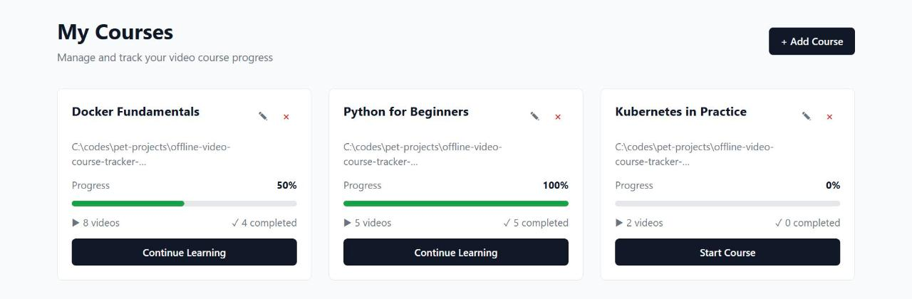
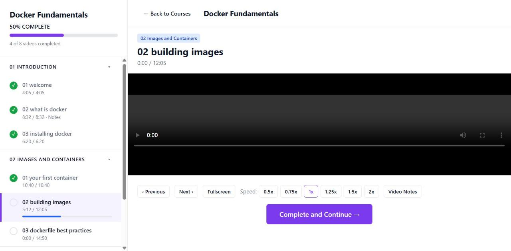

# offline-video-course-tracker-python

Track your progress through video courses you already have on disk: pick a folder, watch the videos in the browser, mark them complete, resume where you left off and keep notes per video.

This is a Python port of my earlier Next.js app. It keeps the same JSON API and the same SQLite schema, so an existing `data/video_progress.db` works as-is.

## Screenshots

**My Courses**: every course with its progress.



**Course player**: sections from subfolders, completed videos ticked, the resume position of the current video, notes and playback controls.



## Features

- **Two kinds of course**
  - **Server Path**: point at a folder on the machine running the app; videos are streamed from there with seeking (HTTP range requests).
  - **Local Files**: pick a folder in the browser (File System Access API, Chromium browsers); the files are copied into the browser's IndexedDB, so this also works when the app runs on another machine.
- **Sections from folders**: each video's parent folder becomes its section; files sort naturally (`2-intro` before `10-outro`).
- **Progress tracking**: completion per video and per course, and the playback position is saved every 5 seconds and on pause.
- **Notes** per video, playback speed, previous/next, and "Complete and Continue" with auto-advance.
- Light and dark theme, following the OS.

## How it works

```text
Browser  ──HTTP──►  Python server (Uvicorn + FastAPI)  ──►  data/video_progress.db (SQLite)
```

- **The Python program is the server.** Uvicorn listens on `127.0.0.1:8000`; FastAPI sends each URL to a Python function, which reads or writes the SQLite file and returns an HTML page, JSON or video data.
- **The browser is the client.** It shows the pages and saves progress by sending small JSON requests (`POST /api/progress`) in the background.
- **Progress is saved on the server, in one file:** `data/video_progress.db`. It records which videos are done, where you stopped, each video's length and your notes. The browser stores no progress; it asks the server every time, so every browser on the PC sees the same progress.
- **Saving while you watch:** every 5 seconds, when you pause, and when you switch video or close the tab. Opening a course jumps to the first unfinished video at the point where you stopped.

### Server Path vs Local Files

| | Server Path | Local Files |
| --- | --- | --- |
| Where the videos are | Left in their folder on disk | Copied into the browser's IndexedDB |
| How a video plays | The server streams the file (with seeking) | The browser reads its own copy; the server never sees the video |
| What the server stores | Course, video paths, progress | Course, video names, progress |
| Works from | Any browser that can reach the server | Only the browser and address (e.g. `127.0.0.1:8000`) where it was added |

Each subfolder of a course becomes a section, and file names become video titles.

> **Back up `data/video_progress.db`** to keep all your progress. The path is relative to the folder the server is started from, so start it from the project folder or set `DATABASE_PATH`.

## Stack

| Layer | Choice |
| --- | --- |
| Web framework | FastAPI (Starlette) on Uvicorn |
| Pages | Jinja2 templates, vanilla JS modules, plain CSS (no build step) |
| Storage | SQLite through the standard-library `sqlite3` module |
| Tests | pytest with FastAPI's `TestClient` |

## Quick start

Requires Python 3.11+.

Windows (PowerShell), from the repository root:

```powershell
cd offline-video-course-tracker-python
python -m venv .venv
.\.venv\Scripts\python.exe -m pip install -e .
.\.venv\Scripts\video-course-tracker.exe
```

Linux / macOS:

```bash
cd offline-video-course-tracker-python
python3 -m venv .venv
.venv/bin/pip install -e .
.venv/bin/video-course-tracker
```

Open <http://127.0.0.1:8000>.

## Usage

```text
video-course-tracker [--host HOST] [--port PORT] [--reload]
```

| Option / variable | Default | Description |
| --- | --- | --- |
| `--host` / `HOST` | `127.0.0.1` | Interface to listen on. Use `0.0.0.0` to reach it from other devices. |
| `--port` / `PORT` | `8000` | Port to listen on. |
| `--reload` | off | Restart on code changes (development). |
| `DATABASE_PATH` | `./data/video_progress.db` | SQLite database file; its folder is created if missing. |

> The Server Path option lets anyone who can reach the app read video files from any folder they name, so keep the default `127.0.0.1` unless you trust your network.

## API

| Method | Path | Description |
| --- | --- | --- |
| `GET` | `/api/courses` | All courses with `totalVideos`, `completedVideos`, `completionPercentage` |
| `POST` | `/api/courses` | Create a course: `{name, type: "server", path}` or `{name, type: "client", courseData: {videos: [...]}}` |
| `GET` | `/api/courses/{id}` | One course with its stats |
| `PATCH` | `/api/courses/{id}` | Rename: `{name}` |
| `DELETE` | `/api/courses/{id}` | Delete a course and its progress |
| `GET` | `/api/courses/{id}/videos` | Videos of a course, in section and file order |
| `POST` | `/api/progress` | Update a video: `{videoId, completed?, watchTime?, duration?, notes?}`; only sent fields change |
| `GET` | `/api/video/{id}` | Stream a server video, or `{type: "client"}` for a local-files video |

Errors are returned as `{"error": "message"}`. Interactive docs are at `/docs`.

## Development

```bash
pip install -e ".[dev]"
pytest
```

## Project layout

```text
app/
├── main.py         # FastAPI app, HTML pages, error format, CLI entry point
├── api.py          # JSON API routes
├── repository.py   # Queries and folder scanning
├── database.py     # SQLite schema and connections
├── templates/      # Jinja2 pages
└── static/         # CSS and JS (course list, player, IndexedDB storage)
tests/              # API and page tests
```
